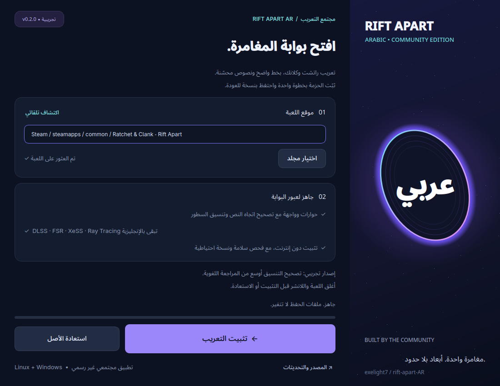

# Rift Apart AR

مشروع تحسين ومراجعة التعريب العربي للعبة **Ratchet & Clank: Rift Apart على الحاسوب**: الحوارات والقوائم والإعدادات والخط العربي.

الحالة الحالية: **v0.2.0 تجريبية**. تصحيح فعلي في **11,700 نصًا (77.48%)** من 15,100 نص غير فارغ خارج الاعتمادات. هذه نسبة تجمع تصحيح الاتجاه والترقيم والتنسيق والمصطلحات؛ المراجعة اللغوية اليدوية الفريدة تشمل **377 نصًا** فقط. اختبار جميع المشاهد داخل اللعبة ما زال مطلوبًا.

[تحميل تطبيق التثبيت من Releases](https://github.com/exelight7/rift-apart-AR/releases/tag/v0.2.0)



فك ZIP بالكامل. شغّل `RiftApartAR.exe` على Windows، أو `RiftApartAR` على Linux (قد تحتاج `chmod +x RiftApartAR`). أغلق اللعبة واللانشر، واختر مجلد اللعبة ثم «تثبيت التعريب». اجعل لغة اللعبة في Steam هي **English**. يتضمن التطبيق كشف مكتبات Steam، تثبيتًا دون إنترنت، فحص سلامة، نسخة احتياطية، استعادة، وتراجعًا عند فشل الكتابة. النسخ المثبتة بهذا التطبيق يمكن تحديثها؛ النسخ القديمة غير المعروفة تحتاج استعادة عبر Steam أولًا.

التطبيق مجتمعي غير رسمي. لا يغير ملفات الحفظ أو تعريفات الجهاز. تقرير النسب التفصيلي في [review/progress_v2.json](review/progress_v2.json).

## ملفات المشروع

| المجلد | المحتوى |
| --- | --- |
| `editable/dialogue/` | حوارات مجمعة حسب رمز المشهد، مع رمز المتحدث |
| `editable/ui_and_other/` | الواجهة والإعدادات والنصوص غير المحسوم تصنيفها |
| `editable/missions/` | المهمات والأهداف والمواقع |
| `editable/tutorials/` | التعليمات والمساعدة |
| `editable/items/` | العناصر والأسلحة والوصف |
| `editable/credits/` | أسماء الفريق |
| `editable/audio_events/` | مفاتيح أحداث الصوت |
| `source/mod_original/` | حزمة التعريب المقدمة للمشروع، بما فيها الخطوط وملفات الواجهة |
| `reference/` | النصوص الخام وفهارس المشاهد والمتحدثين والإحصاءات |
| `patches/` | إصلاح اتجاه اللانشر ومراجعة الإعدادات |
| `review/` | تقارير التحقق ومداخل الحوار الفارغة |
| `tools/` | أدوات الاستخراج والمراجعة والبناء والتحقق |

راجع [المصادر والتراخيص](NOTICE.md) قبل إعادة استخدام المواد. أدوات التطوير مفتوحة المصدر؛ ترخيص التعريب والخطوط الأصليين لم يوثق بعد.

## تعديل الترجمة

افتح ملف JSON داخل `editable/`، وضع الصياغة الجديدة في `arabic_edit` بحروف عربية عادية. تركه فارغًا يبقي النص الخام الأصلي. لا تعدل `key` أو `index`، ولا تحذف سجلًا. الحالات: `todo`، `draft`، `reviewed`، `approved`.

`arabic_current` نسخة آلية للمراجعة؛ اتجاه الترقيم والأرقام والنصوص المختلطة قد لا يكون دقيقًا. المرجع الحرفي هو `reference/all_original.json`.

احفظ متغيرات النص ورموز الأزرار ووسوم التوقيت والتنسيق. يمكن تغيير `<br>` لتنسيق الشرح، لكن لا تغيّر ترتيب توقيتات `<ts=...>`. لا تملأ الفراغات الأصلية اعتمادًا على التخمين؛ بعضها أصوات جهد أو خانات غير مستخدمة. ترتيب المفاتيح لا يضمن تعاقب الحوار داخل اللعبة.

```bash
python3 tools/validate.py
```

راجع [قواعد المراجعة](STYLE_GUIDE.md)، و[المعجم](GLOSSARY.json)، و[التقدم](PROGRESS.md).

## بناء حزمة الاختبار الحالية

يتطلب Python 3 وبيئة افتراضية:

```bash
python3 -m venv .venv
.venv/bin/pip install -r requirements.txt
python3 tools/validate.py
python3 tools/fix_launcher.py
.venv/bin/python tools/build_release.py
python3 tools/package_payload.py
```

النتيجة في `build/release_mod/`. لا تُشحن أرشيفات اللعبة الأصلية مع المشروع. `build_release.py` يرفض استبدال بناء موجود؛ احفظه أو انقله قبل إعادة البناء.

نافذة إعدادات اللانشر تستخدم Unicode عاديًا، بينما واجهة البداية واللعبة تستخدمان صيغة حروف عرض مختلفة. أداة البناء تحافظ على هذا الفصل. بعض مفاتيح إعدادات الحاسوب مشتركة بين الواجهتين وتحتاج تحققًا بصريًا داخل اللعبة.

## تجهيز التركيب محليًا

أغلق اللعبة واللانشر. استخدم فهرس `toc` الأصلي النظيف الموافق لإصدار لعبتك، ثم جهز البناء خارج مجلد اللعبة:

```bash
python3 tools/prepare_install.py \
  --game "/path/to/Ratchet & Clank - Rift Apart" \
  --toc "/path/to/original/toc" \
  --mod build/release_mod \
  --output build/prepared
```

ينتج `toc` معدلًا وأرشيف `arabic_loc` ونسخة `toc.original` وتقرير SHA-256. لا يعدل هذا الأمر اللعبة. ثم:

```bash
python3 tools/install.py \
  --game "/path/to/Ratchet & Clank - Rift Apart" \
  --prepared build/prepared
```

المثبت يتحقق من بصمات الملفات ويحتفظ بنسخة احتياطية محلية. لا يدمج تعديلات أخرى: إذا اختلف الفهرس الحالي عن فهرس البناء الأصلي يرفض التركيب. لا تستخدم فهرس جهاز آخر. الأدوات تفترض أن أصول الحزمة موجودة بالفعل في فهرس اللعبة؛ وتتوقف عند صيغة غير مدعومة بدل التخمين.

لاختبار كل شيء قبل النشر: افتح اللانشر وصفحة إعداداته، ثم صفحات الإعدادات داخل اللعبة، وتحقق من اتجاه الحروف والخط والتوقيت والتفاف النص وعدم اقتطاع العناوين.

## إعادة الاستخراج

`extract.py` يرفض استبدال `editable/`. استخدم نسخة عمل منفصلة، وانقل مجلد التعديلات خارجها أولًا، ثم شغله على المصدر الموجود في `source/mod_original/`. التقارير التي أعيد توليدها من الاستخراج وحده قد تختلف عن التصنيف اليدوي الحالي.

## الترخيص

ترخيص MIT الأصلي محفوظ في [LICENSE](LICENSE). أدوات `tools/` تحت [GPL-3.0](tools/LICENSE)، مع الإسناد إلى Overstrike. المواد الأصلية والخطوط لها حقوق مستقلة موضحة في [NOTICE.md](NOTICE.md).


## تطوير تطبيق التثبيت

```bash
python -m pip install -r installer/requirements.txt
python -m unittest discover -s tests -v
python installer/app.py
```

يجب بناء الحزمة أولًا بالأوامر أعلاه. يبني GitHub Actions نسخ Windows x64 وLinux x86_64 وينشرها كإصدار تجريبي بعد نجاح الاختبارات. لا تضع فهرس اللعبة أو بيانات حسابك في المستودع.
